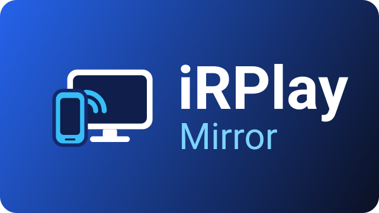
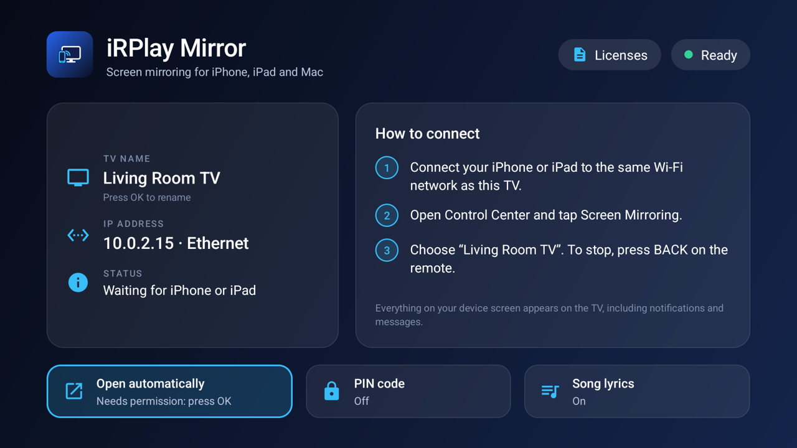

<p align="center">
  
</p>

<p align="center">
  Duplica lo schermo di iPhone, iPad o Mac su una TV Android. Senza Apple TV.
</p>

<p align="center">
  <a href="https://github.com/gninga5/irplay-mirror/releases/latest">Scarica</a> ·
  <a href="#compilarla-da-sé">Compilala</a> ·
  <a href="README.md">English</a>
</p>

---

Tutto è partito da un desiderio semplice: vedere l'iPhone sulla TV del salotto senza comprare
una Apple TV. I ricevitori che ho provato su Google TV erano lenti, pieni di pubblicità, o
tutte e due le cose. Così alla fine me ne sono scritto uno.

iRPlay Mirror gira sulla TV e compare in **Centro di Controllo → Duplica schermo** su qualsiasi
iPhone, iPad o Mac collegato alla stessa rete. Lo tocchi e lo schermo, audio compreso, è sulla TV.

<p align="center">
  
</p>

## Cosa sa fare

La cosa principale è la duplicazione dello schermo, e ci ho passato parecchio tempo perché
sembrasse immediata. Sulla mia Sony (dentro c'è un MediaTek MT5895) un fotogramma passa dalla
rete allo schermo in circa 10–20 ms, fino a 60 fotogrammi al secondo. Per smettere premi
INDIETRO sul telecomando; se il telefono esce dalla portata del Wi-Fi, la TV se ne accorge in
pochi secondi e torna da sola alla sua schermata iniziale.

Fa anche da altoparlante AirPlay. Scegli la TV da Apple Music, Spotify o da un'app di podcast e
compare una schermata "In riproduzione" con la copertina, la barra di avanzamento e, quando si
trova, il testo che scorre a tempo con la canzone. AirPlay i testi non li manda, quindi l'app li
cerca online: prima su [lrcmux.dev](https://lrcmux.dev), poi su [LRCLIB](https://lrclib.net),
poi su [lyrics.ovh](https://lyrics.ovh). Dalla TV escono solo titolo, artista, album e durata
del brano, se la TV è offline non parte nessuna richiesta, e dalla home si può spegnere.
Su quella schermata funziona anche il telecomando della TV: brano precedente, play/pausa e brano
successivo sono pulsanti che raggiungi con le frecce, e sulla barra di avanzamento ◀ ▶ saltano
di 10 secondi. Con Apple Music il salto non è immediato, perché da un ricevitore come questo il
telefono accetta solo l'avanti veloce: un salto di 30 secondi richiede una decina di secondi.

Funziona anche il pulsante AirPlay dentro le app. In YouTube, Safari e in molte altre app,
scegliendo la TV lo schermo non viene duplicato: il telefono passa il video e la TV lo riproduce
da sola, alla qualità piena, mentre il telefono diventa un telecomando per pausa, salti e stop.
Nel frattempo puoi bloccarlo o usare altre app.

Poi ci sono alcune cose che volevo per me:

- **Un PIN la prima volta.** Un iPhone o un Mac nuovo deve digitare le quattro cifre che compaiono
  sulla TV prima di potersi collegare; dopo, viene ricordato. Si può chiedere ogni volta, oppure
  disattivare.
- **Un nome per ogni TV.** Di default usa il nome che hai già dato alla TV in Android, così
  "Cucina" e "Camera" non si confondono. Se la TV ha già AirPlay integrato (le Sony recenti ce
  l'hanno), compare come "Cucina (iRPlay)" per distinguere le due voci.
- **Si apre da sola** quando inizi a duplicare lo schermo, senza doverla avviare prima.
- **Qualità video, fino al 4K.** Standard è H.264, con il ritardo più basso. Alta (HEVC, 1080p)
  dà un'immagine più pulita a parità di banda, e Massima (HEVC, 4K) è la più nitida, soprattutto
  con iPad e Mac. La TV offre solo quello che il suo decoder hardware regge.
- L'interfaccia è in italiano o in inglese, a seconda della lingua della TV.

Cosa non fa: i video protetti (Apple TV+, film comprati su iTunes: quelli si vedono solo su una
Apple TV) e l'audio su più stanze, che richiede il PTP sulle porte UDP 319/320, fuori portata per
un'app su Android senza root.

## Installarla

Scarica l'APK dall'[ultima release](https://github.com/gninga5/irplay-mirror/releases/latest)
e installalo a mano. Con adb ci vuole un minuto:

1. Sulla TV vai in Impostazioni → Sistema → Informazioni e premi OK sette volte su *Build del
   sistema operativo Android TV*. Si sbloccano le opzioni sviluppatore, dove attivi il debug USB
   (e il debug di rete, se la tua TV lo ha).
2. Da un computer sulla stessa rete esegui `adb connect <ip-della-tv>:5555` e accetta la richiesta
   che compare sulla TV.
3. `adb install iRPlay-Mirror-1.7.0.apk`

Serve Android TV o Google TV 9 o successivi su processore ARM, cioè praticamente qualsiasi TV
o chiavetta in commercio. Dovrebbero andare anche le chiavette Amazon Fire TV con Fire OS 7 o 8
(l'APK si installa con l'app *Downloader* o con adb); le più recenti con Vega OS non sono
Android e non possono installarla. Su una Fire TV vera non ho ancora potuto provarla.

Un consiglio: mentre duplichi lo schermo metti la TV in modalità immagine *Gioco*. Gran parte del
ritardo che resta viene dall'elaborazione dell'immagine della TV stessa, e la modalità Gioco la
spegne.

## Come funziona

La TV parla lo stesso protocollo di una Apple TV. Tre livelli: Kotlin per Android
(`app/src/main/java`), un guscio C++ per socket, thread e flusso del protocollo
(`app/src/main/cpp`) e un nucleo Rust per tutto ciò che legge byte mandati dal telefono, più
tutta la crittografia (`app/src/main/rust`). Il C++ vede solo valori già controllati da Rust.

```
Kotlin   MainActivity (SurfaceView, telecomando)   AirPlayService (servizio in primo piano, mDNS)
           CodecManager (MediaCodec)                  AudioRenderer (AudioTrack)
              ▲ JNI
C++      server RTSP · sessioni · socket e thread · FairPlay (playfair) · watchdog 3 s
              ▲ interfaccia C (rust_core.h, con versione; nessun panic la attraversa)
Rust     plist · RTSP/HTTP · DMAP · HLS · H.264/HEVC (riscrittura SPS/VPS) · ALAC (Symphonia)
         buffer di riordino RTP · pairing, PIN (SRP-6a), chiavi · AES-CTR/CBC (istruzioni ARMv8)
```

Alcune cose mi hanno fatto perdere un po' di tempo, quindi le lascio qui: magari a qualcun
altro risparmiano una serata.

- iOS non dice mai se il suo flusso H.264 usa B-frame, così i decoder MediaTek tengono un buffer
  di riordino "per sicurezza" e trattengono fino a 18 fotogrammi. Riscrivere l'SPS dichiarando
  zero fotogrammi da riordinare (lo stesso trucco di Moonlight) ha portato la latenza da qualche
  centinaio di millisecondi a circa 11 ms. Se un giorno arrivassero B-frame, l'app torna all'SPS
  originale.
- Dopo il primo collegamento iOS salta `pair-setup` e passa direttamente a `pair-verify`.
- Con YouTube il telefono non manda un link che la TV possa aprire, ma `mlhls://localhost/master.m3u8`:
  le playlist stanno sul telefono. La TV le chiede una alla volta su una connessione HTTP
  "rovesciata", espande gli indirizzi abbreviati dei segmenti di YouTube e le passa a ExoPlayer
  direttamente dalla memoria, senza aprire altre porte sulla TV.
- Sulla connessione "rovesciata" iOS non risponde solo `HTTP/1.1 200 OK`: ogni 15 secondi circa
  manda un `EVENT/1.0 200 OK` vuoto. Se lo tratti come un errore e chiudi la connessione, la TV non
  può più chiedere le playlist. È questo che bloccava il cambio di traccia audio in YouTube, che
  toglie il video e lo reinserisce (`playlistRemove`, poi `playlistInsert`).
- Dopo quel reinserimento l'iPhone segue il nuovo video solo quando il ricevitore manda l'evento
  `currentItemChanged` (`sessionID`, `type`, `uuid`, `itemCurrent`; niente `category`). Senza,
  il telefono resta con la rotellina e non manda più comandi. UxPlay lo manda *prima* di chiedere
  le nuove playlist ([PR 579](https://github.com/FDH2/UxPlay/pull/579)); con iOS 27.2 così il
  telefono ignora la richiesta di playlist, quindi qui parte *dopo* che le playlist sono arrivate.
  Le risposte a `/action` contengono un plist `errorCode`, `/playback-info` indica l'`uuid`
  dell'elemento corrente e resta vuoto finché l'elemento non è pronto. Provato con iOS 27.2 e
  l'app YouTube.
- Il telefono comunica anche le tracce scelte in `selectedMediaArray` (`soun` per l'audio,
  `sbtl`/`clcp` per i sottotitoli, con la lingua), e la TV le trasforma in preferenze del lettore.
  YouTube però non mette mai i sottotitoli in ciò che trasmette: li spegne appena parte AirPlay,
  e la playlist non contiene nessuna traccia di sottotitoli. Con la duplicazione dello schermo
  invece si vedono.
- La duplicazione in HEVC è il bit 42 delle funzioni ("screen multi codec") più uno schermo
  3840×2160 in `/info`; iOS manda allora un pacchetto di configurazione `hvc1` con VPS, SPS e PPS.
  Il modulo Rust riscrive VPS e SPS per dichiarare zero fotogrammi da riordinare, come il trucco
  di H.264, e torna indietro se compaiono B-slice. iOS 27.2 però li manda già senza riordino: su
  una TCL con chip Realtek i ~30 ms che il 4K aggiunge rispetto a H.264 sono tempo di
  decodifica, non fotogrammi trattenuti.
- Il bit `0x80` nel campo `flags` dell'annuncio mDNS significa "password richiesta". Se lo metti
  per sbaglio, iOS 27 chiede un PIN e poi rinuncia.
- In pausa iOS chiude il flusso audio e lo riapre alla ripresa, mentre la sessione resta aperta.
  Se lo interpreti come "la musica è finita", lo schermo continua a saltare avanti e indietro.
- iOS manda l'audio con circa 1,8 s di anticipo e, una volta al secondo, dice quale campione
  dovrebbe suonare in quel momento. Suonare i pacchetti appena arrivano funziona, ma la TV finisce
  1,8 s avanti rispetto al telefono, e a ogni pausa e ripresa la barra salta. I pacchetti devono
  aspettare il loro momento, come su una Apple TV.
- In pausa iOS continua a mandare pacchetti per qualche secondo, ed è silenzio puro. Solo il
  suono vero conta come "la musica è ripartita".
- I comandi alla musica dalla TV passano per DACP: il telefono manda `DACP-ID` e `Active-Remote`
  nelle intestazioni RTSP e annuncia `iTunes_Ctrl_<id>` via mDNS. L'ID è un numero a 64 bit e a
  volte da una delle due parti perde lo zero iniziale, quindi va confrontato come numero.
  Apple Music risponde 400 a `dacp.playingtime`, ma accetta `beginff`/`playresume`.
- Il decoder ALAC di riferimento di Apple si fida del numero di campioni scritto in ogni
  pacchetto, e su ARM legge la propria configurazione con i byte al contrario. Li avevo
  corretti entrambi, poi ho scoperto che ha vulnerabilità note mai sistemate (il repository è
  fermo dal 2012). L'app è passata al decoder di FFmpeg, e ora a quello di
  [Symphonia](https://github.com/pdeljanov/Symphonia), scritto in Rust senza codice `unsafe`:
  su oltre un milione di pacchetti dell'encoder di riferimento di Apple, otto tipi di segnale,
  frame interi e parziali, coincide bit per bit con l'audio originale, esattamente come FFmpeg.
  L'encoder di Apple resta in `tools/hosttest` per generare i pacchetti dei test.
- AES su ARM a 32 bit: quasi tutte le TV Android hanno un sistema a 32 bit su una CPU ARMv8
  con le istruzioni AES, ma né Mbed TLS (compilato per ARMv7) né RustCrypto le usano lì. Sulla
  TCL l'AES a tabelle di Mbed TLS faceva 25 MB/s, quello a tempo costante di RustCrypto 19 MB/s;
  un piccolo motore con AESE/AESMC (`aes128.rs`, attivo solo se il kernel segnala HWCAP2_AES)
  fa ~680 MB/s ed è a tempo costante per costruzione. È verificato con i vettori NIST e contro
  RustCrypto sul dispositivo stesso.
- La parte in Rust intercetta i propri panic al confine con il C (`guard` in `lib.rs`): un
  pacchetto che fa inciampare una libreria costa quel pacchetto, non l'app.

La catena con cui vengono ricavate le chiavi è descritta in cima a `airplay_crypto.h`.

## Compilarla da sé

```
git clone https://github.com/gninga5/irplay-mirror.git
cd irplay-mirror
./gradlew :app:assembleRelease
```

Serve anche Rust: installa `rustup`, e la compilazione prende da sola il compilatore indicato in
`app/src/main/rust/rust-toolchain.toml` (con i target Android). Una parte del motore nativo sta
passando da C++ a Rust, a cominciare dal codice che legge i dati dalla rete; quella parte la
compila Cargo e finisce nella stessa libreria nativa. Sono già in Rust i parser dei plist
binari, dei messaggi RTSP/HTTP, dei metadati DMAP e delle playlist HLS, tutta la crittografia
(pairing con e senza PIN, chiavi di sessione, decifratura di audio e video), la gestione di
H.264 e HEVC (riscrittura dell'SPS compresa), il buffer di riordino dell'audio RTP e il decoder
ALAC. I vecchi parser C++ restano in `tools/hosttest/reference` solo come metro di
paragone: `parser_diff` dà a entrambi milioni di input generati e alterati e si ferma alla
prima differenza.

L'app non collega più nessuna libreria crittografica in C. I test sul Mac usano ancora Mbed TLS
(submodule git in `tools/hosttest/third_party`, da scaricare con `git submodule update --init`)
e la libsodium di Homebrew, ma solo per fare la parte dell'iPhone: un'implementazione
indipendente con cui verificare la nostra.

Per firmare con una chiave tua, metti `IRPLAY_STORE_FILE`, `IRPLAY_STORE_PASSWORD`,
`IRPLAY_KEY_ALIAS` e `IRPLAY_KEY_PASSWORD` in `~/.gradle/gradle.properties`. Senza, la versione
release viene firmata con la chiave di debug.

### Test

`tools/hosttest/run_tests.sh` esegue, in ordine:
- i test Rust (vettori di prova, fuzzing);
- il motore nativo compilato per macOS con AddressSanitizer e UBSan contro un iPhone
  simulato: pairing e PIN, FairPlay, video e audio cifrati, ALAC senza perdita andata e
  ritorno, il watchdog, richieste malformate;
- `parser_diff`: ogni parser Rust contro il C++ che ha sostituito, su input generati e
  alterati; `crypto_diff`: la nostra crittografia contro libsodium e Mbed TLS; `srp_stress`:
  abbinamenti con PIN contro un client Python indipendente;
- la decodifica con VideoToolbox dei parametri H.264 e HEVC riscritti;
- con `IRPLAY_TEST_DEVICE=<ip>:5555`, di nuovo i test Rust su una TV vera tramite adb (lì ARM
  a 32 bit, AES hardware compreso).

C'è anche un client che parla con l'app nell'emulatore della TV, descritto in
`tools/hosttest/README.md`.

## Riconoscimenti e licenza

iRPlay Mirror è distribuito con licenza **GPL-3.0** (vedi `LICENSE`).

Si regge sulle spalle di [UxPlay](https://github.com/FDH2/UxPlay) e RPiPlay: senza il loro lavoro
per capire il protocollo, niente di tutto questo sarebbe stato possibile. La parte FairPlay usa
*playfair* (GPL-3) e le tabelle di risposta di Juho Vähä-Herttua (LGPL-2.1+). La crittografia
viene da [RustCrypto](https://github.com/RustCrypto) (MIT/Apache-2.0) e dalle librerie
[dalek](https://github.com/dalek-cryptography) (BSD-3-Clause), l'audio Apple Lossless dal decoder
ALAC di [Symphonia](https://github.com/pdeljanov/Symphonia) (MPL-2.0) e le icone dalle Material Icons
di Google (Apache-2.0). Gli avvisi completi sono nell'app, alla voce *Licenze*.

iRPlay Mirror è un progetto indipendente, non affiliato ad Apple Inc. né da essa approvato.
AirPlay, iPhone, iPad e Mac sono marchi di Apple Inc.
