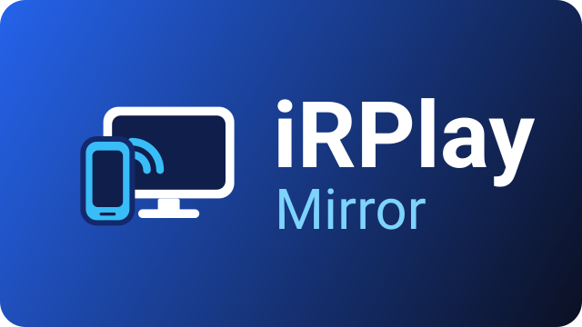
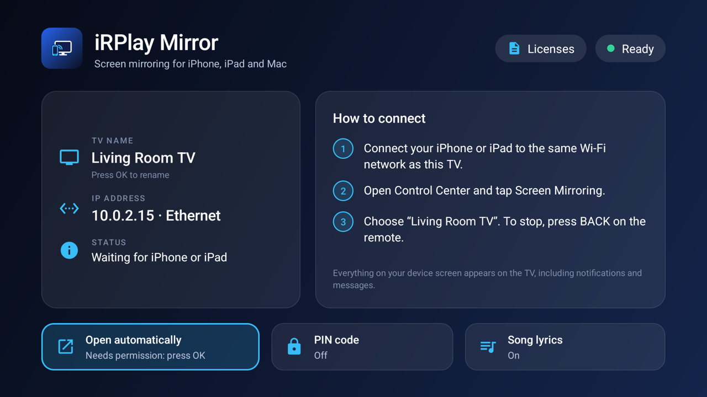

<p align="center">
  
</p>

<p align="center">
  Mirror your iPhone, iPad or Mac to an Android TV. No Apple TV needed.
</p>

<p align="center">
  <a href="https://github.com/gninga5/irplay-mirror/releases/latest">Download</a> ·
  <a href="#building">Building</a> ·
  <a href="#italiano">Italiano</a>
</p>

---

I wanted to put my iPhone screen on the TV in the living room without buying an Apple TV,
and the receivers I tried on Google TV were either laggy, full of ads, or both. So I wrote
my own.

iRPlay Mirror runs on the TV and shows up in **Control Center → Screen Mirroring** on any
iPhone, iPad or Mac on the same network. Pick it and your screen (and sound) is on the TV.

<p align="center">
  
</p>

## What it does

- Screen mirroring from iOS, iPadOS and macOS, with audio
- Hardware video decoding and a pipeline tuned for latency: on my Sony (MediaTek MT5895) a
  frame takes around 10–20 ms from the network to the panel, at up to 60 fps
- Works with the remote: press BACK to stop mirroring
- If the phone walks out of Wi-Fi range, the TV notices within 3 seconds and goes back to the
  home screen
- Can bring itself to the front when you start mirroring (you can turn this off)
- English and Italian, following the TV language

- Works as an AirPlay speaker too: pick it for music or podcasts and the TV shows what's
  playing, with artwork and progress
- Optional PIN, asked the first time a device connects or every time
- Each TV can have its own name

What it doesn't do (yet): HEVC/4K, AirPlay "video" (the kind where YouTube hands the TV a
URL) and multi-room audio.

## Installing

Grab the APK from the [latest release](https://github.com/gninga5/irplay-mirror/releases/latest)
and sideload it. The easiest way is adb:

1. On the TV: Settings → System → About, press OK seven times on *Android TV OS build* to unlock
   developer options, then turn on USB debugging (and network debugging if your TV has it).
2. From a computer on the same network: `adb connect <tv-ip>:5555` and accept the prompt on the TV.
3. `adb install iRPlay-Mirror-1.1.0.apk`

Needs Android TV / Google TV 10 or newer on an ARM chip (pretty much every TV and stick out
there).

Tip: switch the TV to its *Game* picture mode while mirroring. Most of the remaining delay is
the TV's own image processing, and Game mode turns most of it off.

## How it works

The receiver speaks the same protocol an Apple TV does. The networking and crypto are in C++
(`app/src/main/cpp`), the Android side is Kotlin (`app/src/main/java`).

```
Kotlin   MainActivity (SurfaceView, remote)   AirPlayService (foreground service, mDNS)
           CodecManager (MediaCodec)             AudioRenderer (AAC-ELD → AudioTrack)
              ▲ JNI
C++      RTSP server · pairing (Ed25519/X25519) · FairPlay handshake · AES-CTR video / AES-CBC audio
         plist parser · H.264 AVCC → Annex-B · SPS rewrite for low latency · 3 s watchdog
```

A couple of things that took a while to figure out, in case they help someone else:

- iOS never says whether its H.264 stream uses B-frames, so MediaTek decoders keep a reorder
  buffer "just in case" and hold back up to 18 frames. Rewriting the SPS to declare zero
  reorder frames (same trick Moonlight uses) brought latency down from a few hundred
  milliseconds to ~11 ms. If B-frames ever show up, the app switches back to the original SPS.
- After the first connection iOS skips `pair-setup` and goes straight to `pair-verify`.
- The `0x80` bit in the mDNS `flags` record means "password required". With it set, iOS 27
  asks for a PIN and then gives up.

The key derivation chain is documented at the top of `airplay_crypto.h`.

## Building

```
git clone --recursive https://github.com/gninga5/irplay-mirror.git
cd irplay-mirror/app/src/main/cpp/third_party/mbedtls
python3 -m pip install -r scripts/basic.requirements.txt
make generated_files
cd -
./gradlew :app:assembleRelease
```

The mbedTLS step only has to be done once; the Gradle build itself doesn't need Python.
libsodium ships as a prebuilt AAR in `app/libs` (built from the official sources with
`dist-build/android-aar.sh`).

To sign with your own key, put `IRPLAY_STORE_FILE`, `IRPLAY_STORE_PASSWORD`,
`IRPLAY_KEY_ALIAS` and `IRPLAY_KEY_PASSWORD` in `~/.gradle/gradle.properties`. Without them
the release build falls back to the debug key.

### Tests

`tools/hosttest/run_tests.sh` builds the native engine for macOS with AddressSanitizer and
UBSan and runs it against a fake iPhone: pairing, FairPlay, video and audio decryption,
watchdog, malformed requests and a few hundred thousand fuzzed plists and SPS. There's also a
client that talks to the app running in the TV emulator, see `tools/hosttest/README.md`.

## Credits and license

iRPlay Mirror is released under the **GPL-3.0** (see `LICENSE`).

It stands on the shoulders of [UxPlay](https://github.com/FDH2/UxPlay) and RPiPlay, whose
reverse-engineering work on the protocol made this possible. The FairPlay part uses
*playfair* (GPL-3) and reply tables by Juho Vähä-Herttua (LGPL-2.1+). Crypto comes from
[Mbed TLS](https://github.com/Mbed-TLS/mbedtls) (Apache-2.0) and
[libsodium](https://libsodium.org) (ISC). Apple Lossless audio is decoded with Apple's
[ALAC](https://github.com/macosforge/alac) reference decoder (Apache-2.0), with a bounds fix
described in `third_party/alac/PATCHES.md`. The full notices are in the app under *Licenses*.

iRPlay Mirror is an independent project and is not affiliated with or endorsed by Apple Inc.
AirPlay, iPhone, iPad and Mac are trademarks of Apple Inc.

---

## Italiano

iRPlay Mirror trasforma una TV Android / Google TV in un ricevitore per la duplicazione
schermo: da iPhone, iPad o Mac apri il Centro di Controllo, tocca *Duplica schermo* e scegli
**iRPlay Mirror**. Video e audio arrivano sulla TV, con una latenza molto bassa.

Per installarla scarica l'APK dall'[ultima release](https://github.com/gninga5/irplay-mirror/releases/latest)
e installalo con `adb install` (i passaggi sono nella sezione *Installing* qui sopra).
L'interfaccia è in italiano se la TV è impostata in italiano.

Il consiglio più utile: metti la TV in modalità immagine *Gioco* mentre duplichi lo schermo.
